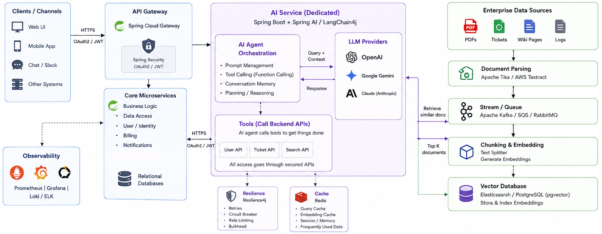

# AI-Enabled Java Microservices

Integrating AI agents and RAG into Java/Spring Boot systems should be done as an extension of existing architecture, not a replacement. Most systems already have strong microservices for business logic, data access, and security. The AI layer should sit on top and reuse these services through APIs.

A clean approach is a separate AI service built with Spring AI or LangChain4j. These frameworks connect Java apps to LLMs like OpenAI, Gemini, or Claude. They handle prompts, tool-calling, and orchestration so the model can safely trigger backend APIs when needed.

For RAG, first collect enterprise data like PDFs, tickets, wiki pages, logs. Parse them using Apache Tika or AWS Textract. Stream processing via Kafka or another queue keeps ingestion async and scalable. Then chunk the content, generate embeddings, and store them in a vector database like Elasticsearch or Postgre PgVector.

At runtime, the AI agent takes a user query, retrieves similar documents from the vector store, and sends both the query and context to the LLM. This improves accuracy and reduces hallucinations.

Important design rule is AI agents isolation. No direct database access. All writes and reads go through secured Spring Boot APIs with Spring Security and OAuth2.

Optionally Resilience4j can be used for retries and circuit breakers, and Redis for caching embeddings and frequent queries.

Done right, this setup adds an intelligence layer on top of stable Java systems, without touching the core.

Original article: https://github.com/roman-vidayko/articles/blob/main/a005/content/AI-Enabled-Java-Microservices.md